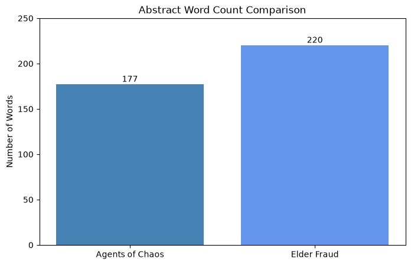

# Web Mining and Applied NLP: Elder Fraud Research Analysis

**Addie Gemmell | November 2026 | Project 05**

## Overview

For my custom project, I analyzed a research paper about elder fraud and the challenges families face when trying to intervene. I wanted to compare the length and structure of its abstract with the original Agents of Chaos paper.

The project uses a Python web mining pipeline to collect information from an arXiv webpage and organize it into structured data.

## Data

My custom data source was the arXiv research paper ["I Don't Think It's a Scam"](https://arxiv.org/abs/2611.24899), which discusses elder fraud and family intervention.

I compared it with the original [Agents of Chaos](https://arxiv.org/abs/2602.20021) paper.

Each record in the processed dataset represents one research paper, including its title, authors, abstract, subject, submission date, and calculated measurements.

## Techniques Applied

I used Python and Requests to retrieve the HTML webpage, BeautifulSoup to extract information, and Pandas to organize the results.

The project follows four EVTL stages:

- Extract: Retrieve the HTML webpage.
- Validate: Check that the required HTML elements exist.
- Transform: Extract information and calculate measurements.
- Load: Save the processed results to a CSV file.

I also used Matplotlib to create a chart comparing the abstract word counts.

## Custom Modifications

For my small technical modification, I added an `abstract_sentence_count` column to the original pipeline.

I wanted to calculate the number of sentences in addition to the existing word count.

The modification increased the DataFrame from 8 columns to 9 without affecting the other calculations.

For my custom application, I changed the data source to a research paper about elder fraud and created a comparison chart.

## Methods and Settings

I updated `src/nlp/config.py` to retrieve the elder fraud paper from arXiv.

The pipeline uses HTML selectors to identify the paper's title, authors, abstract, subject, and submission date.

It calculates word count, sentence count, and author count. I used the results from the original paper as a comparison.

The chart uses the word counts from both papers to display their differences.

## Verification

I ran the pipeline using:

`uv run python -m nlp.pipeline_web_html`

The pipeline completed successfully and created a DataFrame with 1 row and 9 columns.

The processed results were saved to `data/processed/case_processed.csv`.

I also ran:

`uv run python src/create_chart.py`

The chart was successfully saved to `docs/images/abstract_comparison.png`.

The Git hooks passed, and I verified that the chart displays on my published documentation site.

## Results

| Measurement | Agents of Chaos | Elder Fraud Paper |
|---|---:|---:|
| Authors | 38 | 7 |
| Abstract Words | 177 | 220 |
| Abstract Sentences | 9 | 11 |

### Abstract Word Count Comparison

## Observations

The elder fraud paper had 220 words and 11 sentences in its abstract, compared to 177 words and 9 sentences in the original paper.

The original paper had 38 authors, while the elder fraud paper had 7.

The elder fraud abstract was 43 words and 2 sentences longer.

## Interpretation and Insights

The elder fraud paper had a longer abstract despite having fewer authors. This shows that the number of authors does not necessarily correspond with the length of an abstract in these two examples.

I also found it interesting to work with research related to financial fraud because it connects to my work in banking.

## Limitations

One limitation is that I only compared two research papers, so I cannot determine whether these differences represent larger patterns.

The analysis also focuses on abstract length and author counts rather than the full content of the research papers.

## Next Steps

If I continued this project, I would analyze more research papers about financial fraud and compare their abstracts.

I would also like to explore text analysis techniques to identify frequently used words and common topics across the papers.

## Project Links

- [My GitHub Repository](https://github.com/ajerineg-coder/nlp-05-web-documents-custom)
- [My Project README](https://github.com/ajerineg-coder/nlp-05-web-documents-custom/blob/main/README.md)
- [Original Example Project](https://github.com/denisecase/nlp-05-web-documents)
- [Elder Fraud Research Paper](https://arxiv.org/abs/2611.24899)
- [Agents of Chaos Research Paper](https://arxiv.org/abs/2602.20021)
